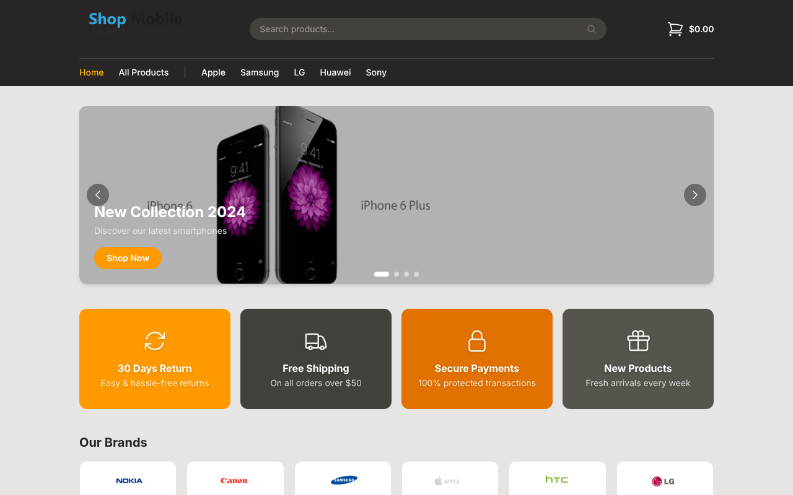
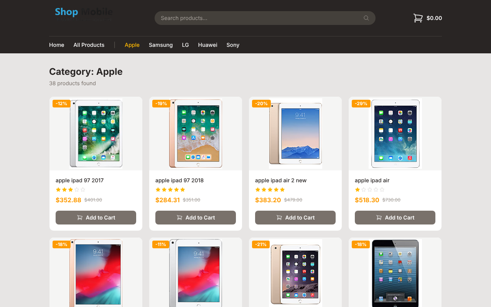
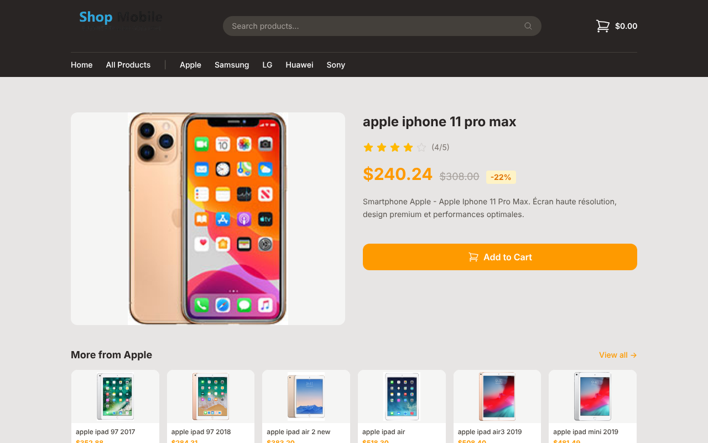
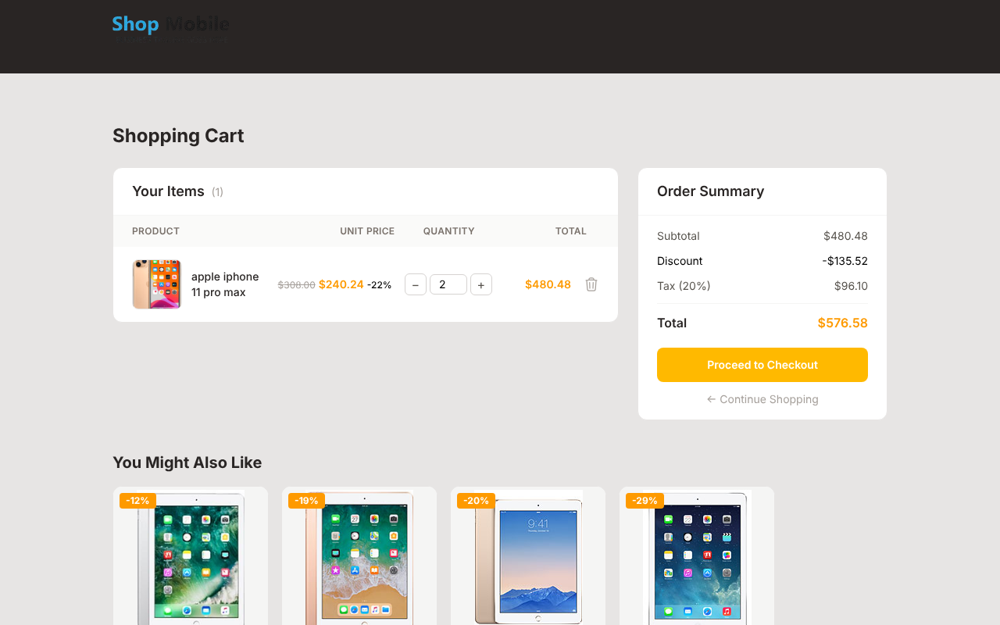
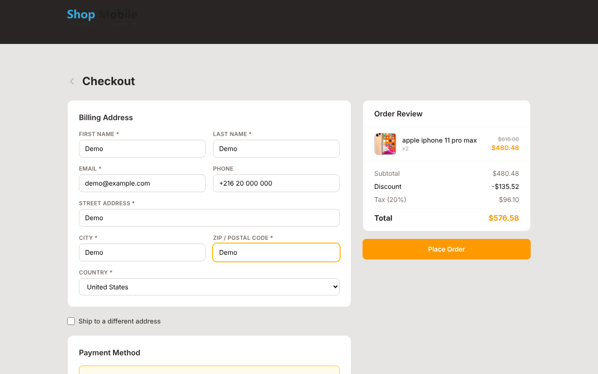

<p align="center"></p>

# Phone Web Shop

[](https://github.com/Ghorbel37/react-ecommerce-storefront/actions/workflows/ci.yml)

**Live demo: [ghorbel37.github.io/react-ecommerce-storefront](https://ghorbel37.github.io/react-ecommerce-storefront/)**

> This project was built as part of a **React training program**, covering core React concepts through a practical, real-world e-commerce application.

A full-featured e-commerce storefront built with React, TypeScript, and Tailwind CSS, backed by a local JSON Server mock API.



| Browse | Product |
|---|---|
|  |  |
| **Cart** | **Checkout** |
|  |  |

## Features

- **Home page**: hero carousel, promotional banners, product sections by category, and brand highlights
- **Browse & search**: paginated product grid, filter by category, search by keyword, or combine both
- **Product details**: image gallery, product info, recently viewed, and other products from the same brand
- **Shopping cart**: add/remove/update quantities, per-item discount display, order summary with tax
- **Checkout**: billing & shipping address forms, payment method selection, order placement

## Tech Stack

| Layer | Technology |
|---|---|
| UI | React 19, TypeScript |
| Routing | React Router v7 |
| State | Redux Toolkit + React Redux |
| Styling | Tailwind CSS v4 (`@tailwindcss/vite`) |
| Icons | Heroicons |
| Bundler | Vite |
| Mock API | json-server 0.17, or the same data served in the browser |
| Tests | Vitest + jsdom |

## Project Structure

```
├─ src/
│  ├─ App.tsx               # Router definition
│  ├─ api/
│  │  ├─ client.ts          # apiFetch(): json-server or in-browser mock
│  │  └─ mockApi.ts         # json-server stand-in reading api/db.json
│  ├─ pages/                # Route-level page components
│  ├─ components/
│  │  ├─ header/            # Navbar, SearchBar, MiniCart
│  │  ├─ home/              # Carousel, ProductCard, Promo, Brands
│  │  ├─ browse/            # BrowseProductCard, Pagination
│  │  ├─ product/           # ImageGallery, ProductInfo, etc.
│  │  ├─ cart/              # CartProductRow, CartTotalsTable, SimilarProducts
│  │  ├─ checkout/          # AddressForm, OrderReview, PaymentMethods
│  │  └─ footer/
│  └─ store/
│     ├─ cartSlice.ts       # Cart state + async thunks
│     ├─ cartTotals.ts      # Subtotal, discount, 20% tax, total
│     └─ store.ts
└─ api/
    └─ db.json              # Mock database (products, categories, carts, orders)
```

## Getting Started

### Prerequisites

- Node.js 18+
- npm

### Installation

```bash
# Install frontend dependencies
npm install

# Install API dependencies
cd api && npm install && cd ..
```

### Running the App

```bash
npm run dev
```

Then open [http://localhost:5173](http://localhost:5173) in your browser. By default the app answers its API calls in the browser from the bundled `api/db.json`, and keeps carts and orders in `localStorage`. This is how the live demo runs on GitHub Pages.

To use the real json-server API instead, run it in a second terminal and start the app in `api` mode (reads `VITE_API_URL` from `.env.api`):

**Terminal 1: Mock API (port 3001)**
```bash
npm run json-server
```

**Terminal 2: Frontend (port 5173)**
```bash
npm run dev:api
```

### Tests

```bash
npm test
```

Covers the cart (add, quantity, remove, clear, restore after reload), the totals with discounts and tax, and the in-browser API (filters, search, pagination).

### Build for Production

```bash
npm run build
```

GitHub Actions runs the tests and the build on every push, and deploys `main` to GitHub Pages.

## API Endpoints

The mock API is served by `json-server` at `http://localhost:3001`.

| Method | Endpoint | Description |
|---|---|---|
| GET | `/products` | List products (supports `?categoryId=`, `?q=`, `?_page=`, `?_limit=`) |
| GET | `/products/:id` | Single product |
| GET | `/categories` | All categories |
| GET/POST | `/carts` | Get or create a cart |
| PUT | `/carts/:id` | Update cart contents |
| POST | `/orders` | Place an order |